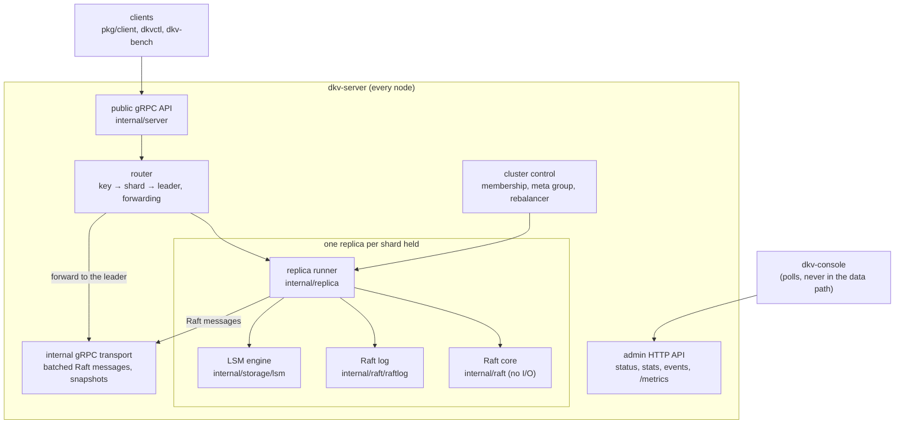
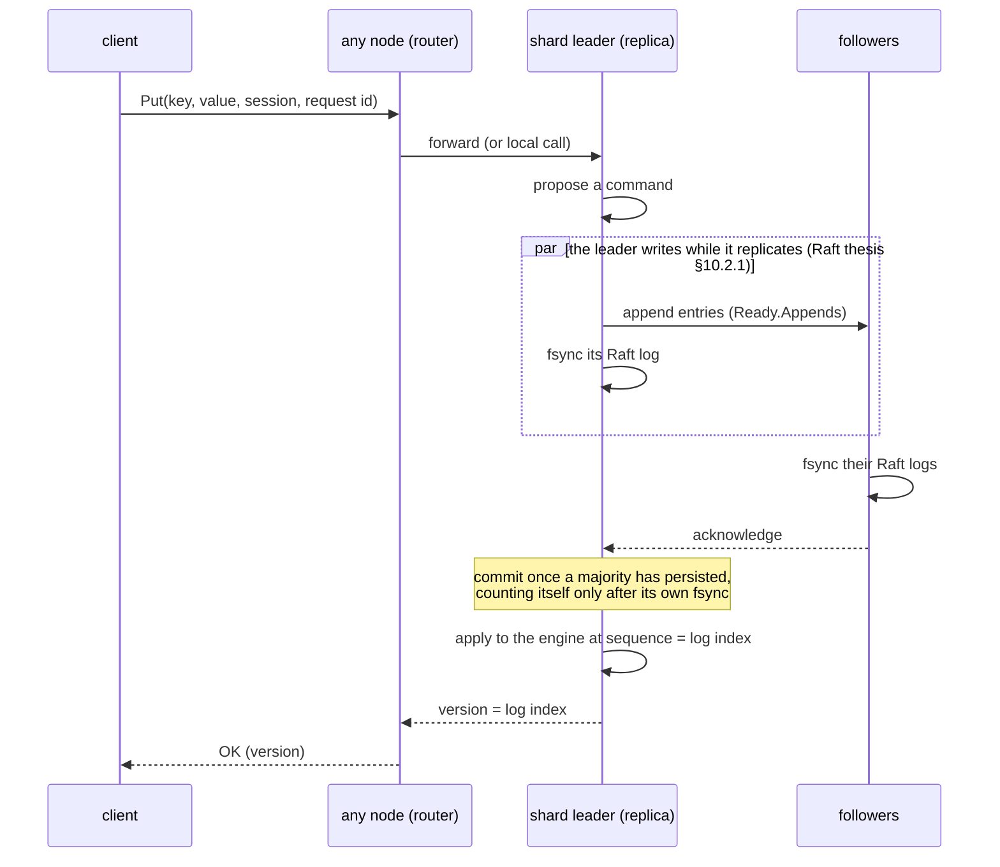
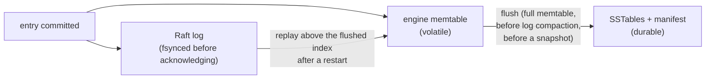

# dkv architecture

dkv is a sharded key-value store: a fixed number of hash shards, each one a
Raft group of (by default) three replicas, each replica with its own LSM
storage engine. Every node runs the same binary and accepts any key. This
page is the map; the decisions and their alternatives are in `docs/adr/`,
the plan in `docs/PLAN.md`, the on-disk formats in `docs/storage-format.md`.

## Layers

Storage knows nothing about Raft, gRPC or clusters; the Raft core has no
goroutines, timers, network or disk calls (ADR 0003); only the replica
joins them. `depguard` rules in `.golangci.yml` keep it that way.

## A write

Reads are linearizable by default: the leader confirms with a heartbeat
round that it still leads (ReadIndex, ADR 0007), waits until it has applied
that index, and reads its engine. Stale reads answer from any replica's
engine, optionally waiting for a minimum version. A client session and
request ID make a retried write apply once (ADR 0008).

## The replica runner

Each replica's goroutine drives its Raft core through `Ready` and
`Advance`. In order:

1. install a snapshot the core accepted, if any, and send the leader's
   appends (`Ready.Appends`), which may go before anything is persisted;
2. persist the HardState and new entries to the Raft log, with fsync when
   the core says so (new entries, a new term or vote);
3. send the other messages (votes, acknowledgments: never before the state
   they promise is durable);
4. apply committed entries to the engine, answer confirmed reads;
5. `Advance`, which is where a leader counts its own persisted entries
   toward a commit.

## Durability

A replica's Raft log is its only write-ahead log (ADR 0010). Applying an
entry writes a batch to the engine at sequence number = the entry's index,
in memory; the engine makes it durable by flushing whole memtables to
SSTables. After a crash the engine reopens at its last flushed index and
the replica replays the Raft log above it. The log is compacted only after
the engine has flushed past the compaction point, so it always holds what
the engine might have lost. `storage.engine_wal` brings back a second log
per replica, for comparison; a standalone node always keeps its engine's
log.

## Cluster management

- **Placement:** shards are placed on a consistent-hash ring over the
  eligible nodes (ADR 0002, 0023); a new node takes its share.
- **Meta group:** a Raft group of its own holds the node records, shard
  descriptors and settings (ADR 0011). Its leader collects heartbeats,
  declares nodes dead after `liveness.dead_after` (ADR 0013), and runs the
  rebalancer: one membership change at a time per group, learners first,
  leadership moved off a voter before it is removed, leadership balanced,
  drained nodes emptied of leadership (ADR 0012).
- **Failure detection between peers:** every node pings its bootstrap
  peers and reports them up or down within `cluster.down_after`.

## Observability

Each node keeps request counters with latency histograms, internal
latencies (Raft-log fsync, commit), Raft and engine state per replica, and
a ring of recent events (elections, failure detection, membership changes,
snapshot installs). Its admin HTTP API serves them as JSON and Prometheus
metrics. `dkv-console` polls every node, derives rates and percentiles
from the counters, merges the events, keeps a history (PostgreSQL or
memory) and serves the dashboard (`web/`) over REST and server-sent events
(ADR 0014, 0015).

## Testing

| Layer | Where | What |
| --- | --- | --- |
| Unit and model | every package | invariants of each component against simple models |
| Fault filesystem | `internal/storage/vfs` | power loss at every filesystem operation of the WAL, flush, compaction, snapshot install |
| Simulation | `internal/sim` | the Raft core under drops, delays, reordering, partitions, crashes (including between a leader's send and its persist) and membership changes; safety checks every step, liveness after calm |
| Integration | `test/integration` | in-process clusters over real gRPC |
| Linearizability | `test/linearizability`, `test/chaos` | the failure matrix in process and in Docker, histories checked by Porcupine; every scenario proves its faults took effect |
| Crash | `test/crash`, `test/e2e` | SIGKILL of real processes |
| Dashboard | `test/dashboard`, `web/` | the console against a real cluster; the UI in jsdom and in Chromium |
| Benchmarks | `cmd/dkv-bench`, `bench/` | YCSB-style workloads, reproducible with `make bench-local` |
